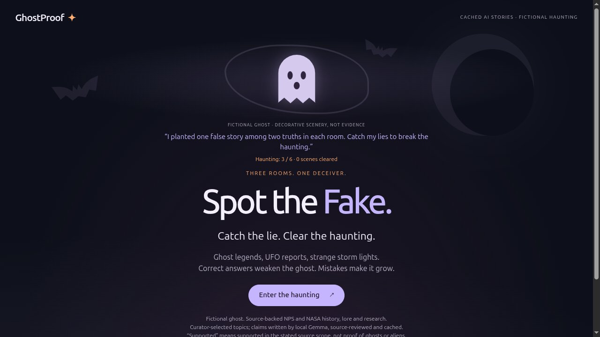

# GhostProof

Catch one fabricated claim in each of three haunted rooms. GhostProof turns source-reading into a short Halloween game: correct answers weaken the fictional ghost; mistakes make it grow.

The rooms cover **St Paul's ghost stories**, **NASA's independent UAP study**, and **sprites above thunderstorms**. These are source-scoped claims—not proof of ghosts, aliens, or universal model accuracy.



## Play from a clean clone or ZIP

Requires Node.js 22+ and Python 3.10+. There are no package dependencies to install, accounts to create, API keys to provide, or model weights to download. From this directory:

```sh
python3 tools/validate_release.py
python3 tools/build_site.py
python3 -m http.server 8080 --bind 127.0.0.1 --directory site
```

Open <http://127.0.0.1:8080/> in a current browser. Serve **only `site/`**, never the repository or historical reference directory. Browser integrity checking requires HTTPS or localhost; opening an HTML file directly or using an insecure remote HTTP origin is unsupported. Stop your preview with Ctrl+C. If files are missing or fail verification, restore a verified package and reload; “Start a fresh hunt” retries loading without inventing fallback content.

Repository: [aydin41k/ghostproof](https://github.com/aydin41k/ghostproof). The initial release was pushed privately with Actions disabled. The owner has now authorized public visibility, MIT for original code/art, and the free GitHub Pages/standard public Actions route. Public access, a hosted CI run, and deployment are still pending verification. Public demo or walkthrough URL: **not available yet**. The [release checklist](docs/release-checklist.md) tracks the remaining checks.

## What runs where

The actual local model `gemma4-e4b-local:latest` prepared the claims in advance under a frozen source-paraphrase contract. Five real calls produced three accepted, separately agent-reviewed topics. Their exact accepted claim text, quotations and containing passages are exported in `demo/content.json`.

This release is a **cached, browser-local adaptation** of the earlier loopback prototype. The browser loads five same-origin files and then plays/replays without model or upstream-source requests. Opening an optional source link is your own navigation to NASA or NPS. There is no inference during play, account, telemetry, storage, leaderboard or laptop connection. A fresh page load still needs the static files; offline reload is not implemented.

Answers live in the bundle and are inspectable. Hiding evidence from the choosing screen is a presentation choice, not anti-cheat security. A content checksum catches release drift; it does not prove truth. “Supported” always refers to the stated source scope. In particular, the sprite correction “Sprites occur far above those cloud tops.” stays paired with the full fabricated claim identifying the cloud tops.

## Validate, build and package

```sh
node --test tests/*.test.js
node --check demo/app.js
node --check demo/game.js
PYTHONDONTWRITEBYTECODE=1 python3 -m unittest discover -s tests -p 'test*.py' -v
python3 tools/validate_release.py
python3 tools/build_site.py
python3 tools/package_release.py
python3 tools/package_release.py --smoke
```

The last command extracts the exact source ZIP into a new temporary directory, then validates, builds, and runs both the Node game/client tests (including full hunts and reset) and the Python boundary suite there. Only the recursive extraction test is skipped inside that extracted child; all other boundary tests run. Output: `dist/ghostproof-1.0.0.zip`, its SHA-256 sidecar and a per-file SHA-256 manifest. `site/` is the smaller, five-file web-public allowlist. Unknown or symlinked source files fail validation; generated directories are not packaged.

## Hosting and automation

Any HTTPS static host can serve the generated `site/` directory, including a project subpath. No dynamic backend is required. `render.yaml` prepares a static site with automatic deployment switched off; no Render service has been created. Check free-account limits and paid-overage settings before connecting a repository. This cached frontend's Render category eligibility is not assumed.

GitHub Actions CI is prepared and tested locally. After independent review and exact Git-tree verification, root must verify public visibility before enabling Actions on standard public runners. That compute and GitHub Pages are the confirmed free route; this does not claim that arbitrary artifacts or account-wide usage are free. CI validates and rehearses the package without retaining an optional artifact. No successful hosted run is claimed yet. The Pages workflow is **manual-only**: root selects GitHub Actions in repository Pages settings and explicitly runs “Manually deploy static demo to Pages.” It publishes only `site/`, using the required one-day Pages artifact, not the source package. It has not been dispatched. See [hosting/CI evidence](docs/release-checklist.md).

## Provenance and rights

[Provenance](docs/provenance.md) records accepted candidate hashes and limitations. [Historical preparation code](reference/local-preparation/README.md) is included only for source audit; private source/response ledgers are not shipped, so full historical regeneration from this package is not claimed.

Original code and SVG/CSS artwork are offered under the [MIT License](LICENSE). Attributed third-party excerpts and unestablished generated-text rights are excluded; see [LICENSING.md](LICENSING.md) and [source credits/third-party boundaries](THIRD_PARTY_NOTICES.md). Public release authorization is not third-party legal clearance. No NASA/NPS photos or logos are included. The original decorative scenery is code-native SVG/CSS, not source evidence.

The [submission draft](docs/submission-draft.md), [category status](docs/bonus-checklist.md), and [walkthrough narration](docs/narration-script.md) are preparation aids, not a published entry or eligibility guarantee.
